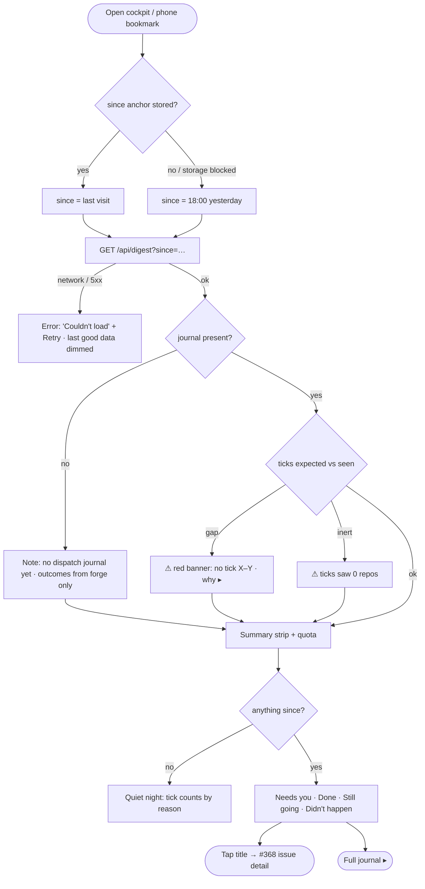
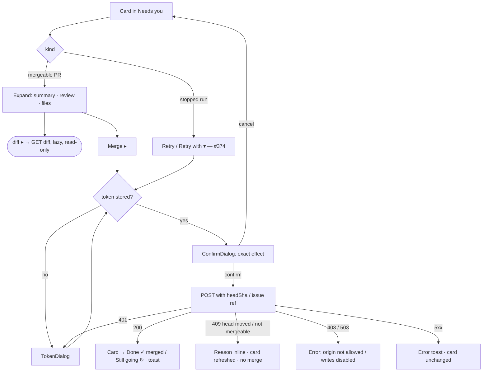
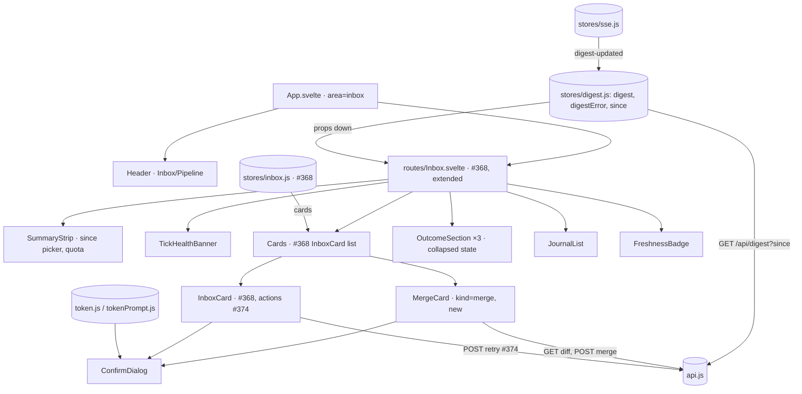

# Cockpit — Today (morning digest): flow

Approved 2026-11-11 (Phase 2, `/ui:flow`). Wireframe: [`wireframe.md`](wireframe.md).
Design: [`docs/superpowers/specs/2026-11-11-cockpit-today-design.md`](../../superpowers/specs/2026-11-11-cockpit-today-design.md).

Endpoint paths are proposals; final names are the builder's call. Today
**extends #368's Inbox page**, so components hang off `routes/Inbox.svelte`
and reuse #368's names. Retry / Retry with / Park are #374's actions.

## 1a — Journey: open and read

- `since` is stored as "last visit" when the page is **left or hidden**, not on
  load, so a reload during the morning read does not wipe the window.
- SSE `digest-updated` / `inbox-updated` triggers a re-fetch (same pattern as
  the Board).

## 1b — Journey: Merge and Retry

- Merge sends the `headSha` the review verdict was for. The server re-checks
  head unchanged, checks green, not draft, mergeable, and answers `409` with the
  reason otherwise. The button's guard is never trusted on its own.

## 2 — Component and state map

- **Ownership:** `stores/inbox.js` (#368) stays as is and feeds the cards. A
  sibling `stores/digest.js` holds the digest payload, error and `since`
  (localStorage wrapped in try/catch); `MergeCard` holds expanded + diff state
  (diff fetched once, cached per head SHA); `OutcomeSection` holds its collapsed
  state.
- **Events up:** cards emit `acted`; `Today` re-fetches. No optimistic state
  beyond a pending spinner.
- **Server side:** `GET /api/digest` reads the dispatch journal, run markers, PR
  summary / review / checks from collector snapshots and the #371 meter, with
  no per-request forge fan-out. The diff endpoint is the one lazy, per-click
  exception.

## Screen inventory (implied, not in the wireframe)

1. Since picker (`change ▾`) — dropdown with presets.
2. Full journal view — every tick, filter by lane / dry-run; own route.
3. "why ▸" for missing ticks — inline panel: expected tick times, `journalctl` hint.
4. Full AI review (`full ▸`) — inline rendering of the review comment.
5. Retry-with picker and Park — #374; issue detail — #368. Referenced only.
6. Token entry — existing `TokenDialog`.
