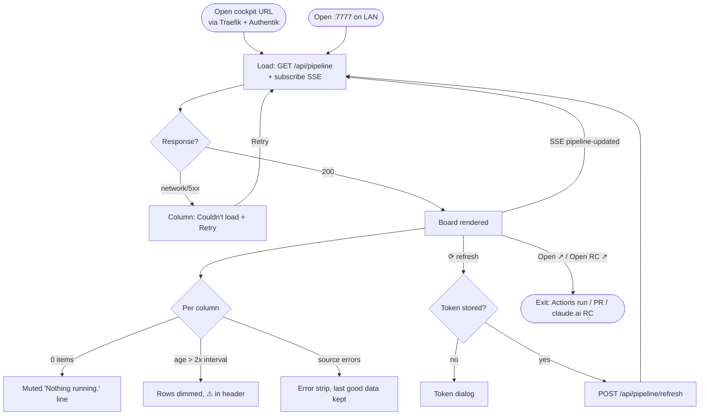
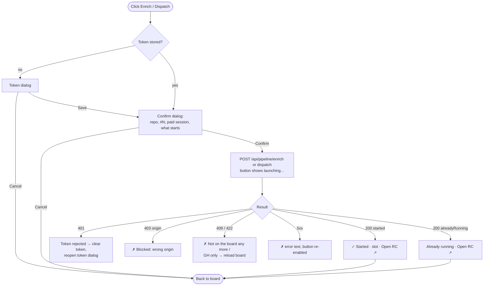
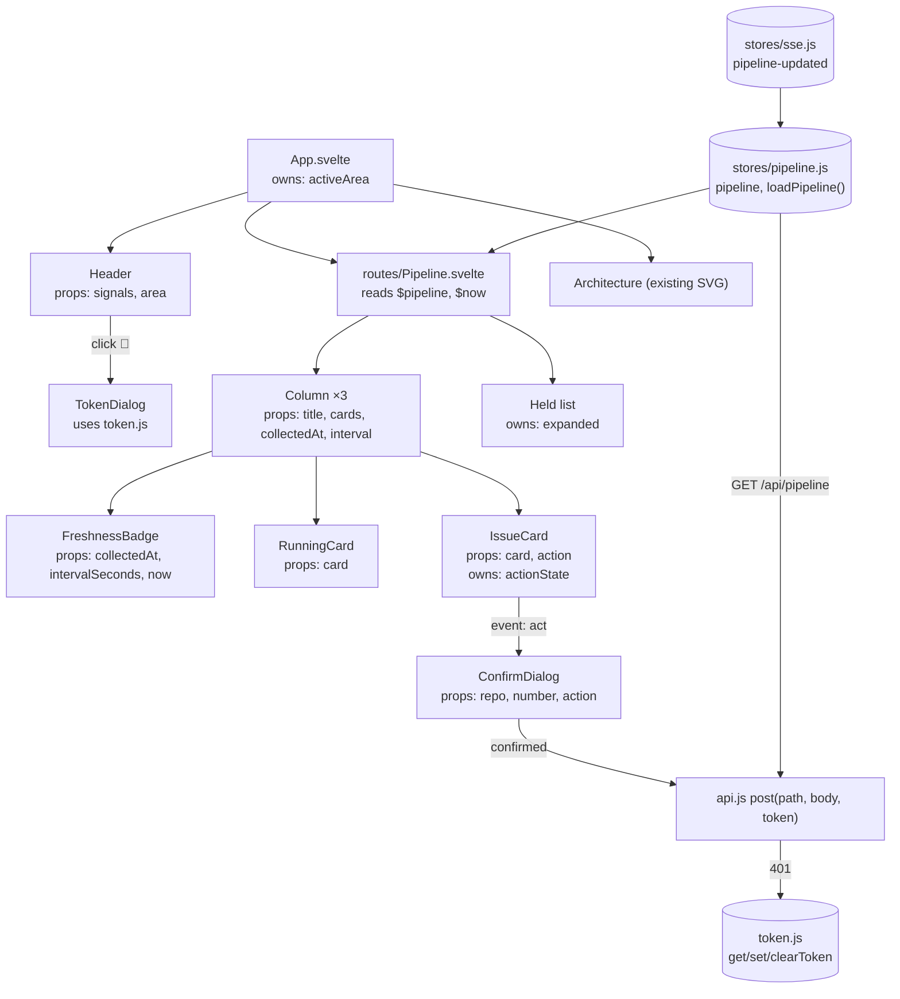
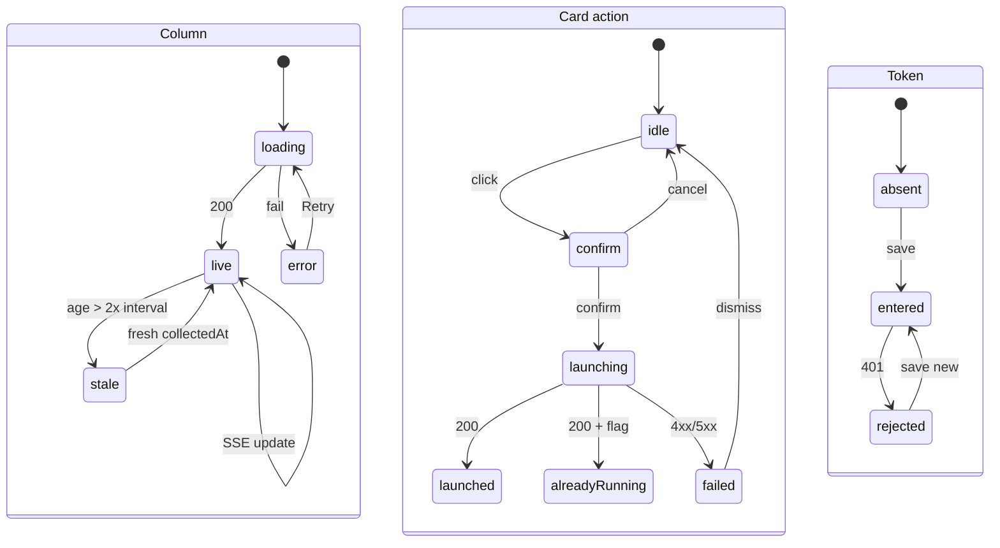

# Cockpit — shell + Pipeline board: flow

Approved 2026-10-26 (Phase 2, `/ui:flow`). Wireframe: [`wireframe.md`](wireframe.md).

## 1a — User journey: opening the board

## 1b — User journey: acting from a card

## 2 — Component & state map

Props down, events up. Shared state lives only in the `pipeline` store and
`token.js`; per-card action state lives in the card; the Held expand toggle in
the Held list. `$now` is a 1 s ticker store so ages stay correct without SSE.

## 3 — State machines

## Screen inventory

- TokenDialog, ConfirmDialog: in the wireframe.
- Error strip "dismiss": hides an error only until the next board update; a
  still-failing source shows again.
- Held / "show N more": in-board toggles, not screens.
- Deliberately absent: card detail view — Open ↗ links to GitHub / claude.ai.
