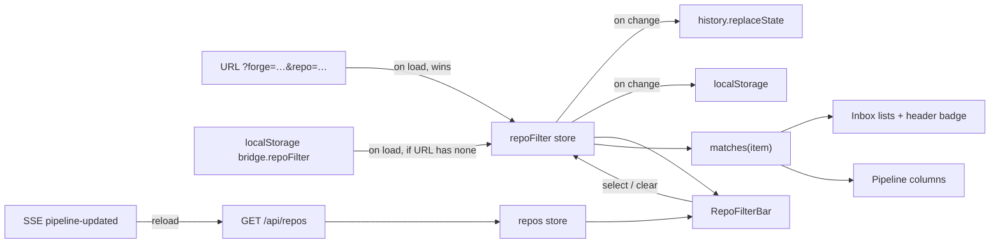
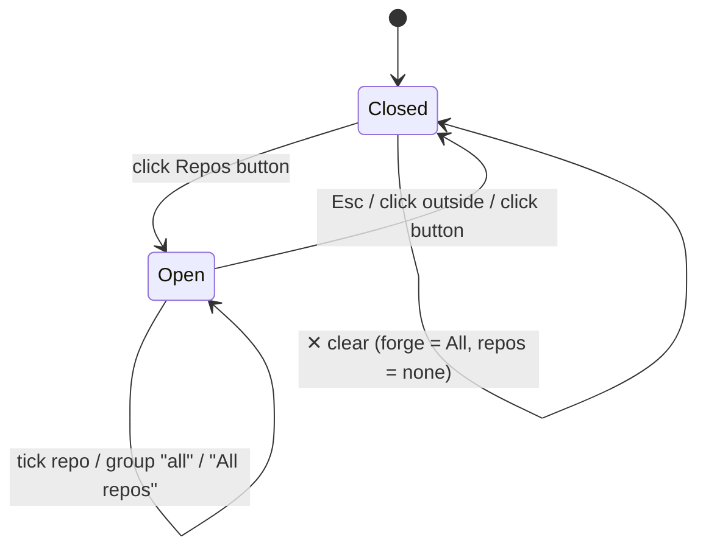
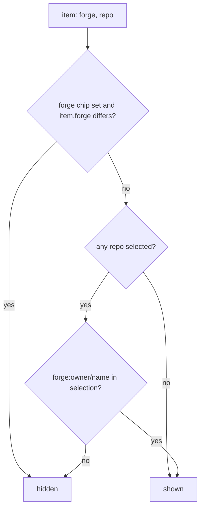

# Cockpit repo filter bar: flow

Phase 2 (`/ui:flow`). Wireframe: [`wireframe.md`](wireframe.md).

## State and data

## Bar interaction

## Matching rule

An item without a repo (a session outside every discovered repo, `repo: ""`)
is shown only when no forge and no repo is selected.
