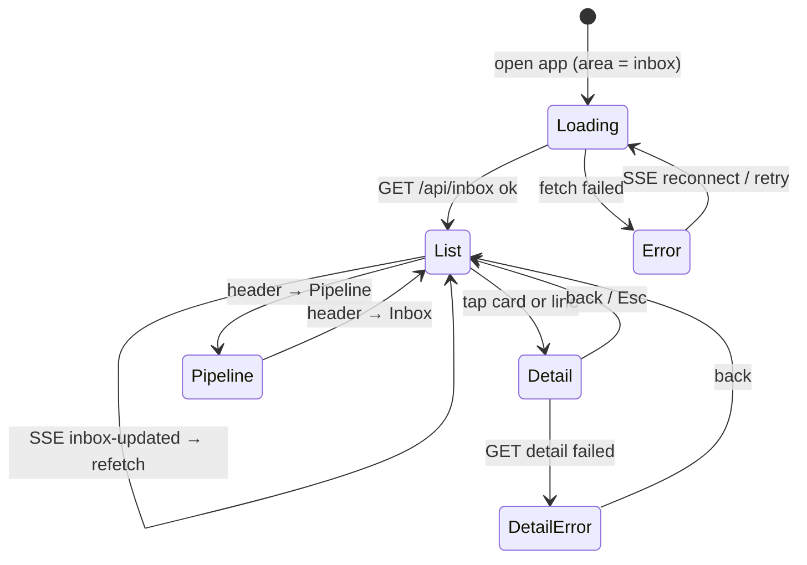

# Issue inbox in `bridge serve` — design (#368)

## Why

The human should steer from the `bridge serve` web UI and only step in at
decision points, instead of living in individual agent sessions. The unit of work
is the **issue**: it lives on the forge and collects the history; sessions are
short-lived. Since #367, bridge has one answer to "does this issue need a
person?": `dispatch.NextAction` over the pipeline's run marker (agent-workflow
ADR-021). This issue puts that answer on the cockpit's start page.

## Scope (decided 2026-11-11)

This issue is the **read-only** inbox: data, inbox page, issue detail, links.

Split out, each its own issue:

- **Inbox write actions** — Retry, Retry with another agent/model, Park. They
  share the re-dispatch path with #253 (`--retry-only`). Follow-up: #374.
- **Blocked interactive sessions** as cards — only Herdr knows "blocked" today,
  and serve has no Herdr source. Follow-up: #375.
- Unchanged from the original issue: in-UI diff review, usage meter (#371), plugin
  API.

## Corrections to the original issue text

- `agent_timeout` is not a pipeline class. A timed-out run posts no report
  (agent-workflow #567) and reads as "no run report yet" / "no run marker" /
  "retry never reported" (rows 9, 10, 14 of #367's table).
- No fallback parser for the visible report: rejected in #367 (pre-marker reports
  carry no class and no decision). Issues without a marker go to a human (row 10).
- Card triggers are not a separate list: a card is exactly an issue whose
  `NextAction` is `ActionHuman` or `ActionRetry`; a one-line status is
  `ActionWait`. The table lives in `docs/dispatch.md` ("When a run fails").
- "Retry", "Retry with", "Park" and "Open in Claude" move to the follow-ups above.

## What exists (origin/main e0b3c6b)

- `bridge serve` (`cmd/bridge/serve.go`): `/api/pipeline` (read, open) and
  guarded `POST /api/pipeline/{refresh,enrich,dispatch}`; SSE at `/api/events`;
  Svelte 5 SPA embedded from `internal/web/dist`.
- `internal/cockpit`: `Collector` polls `Sources` (issues 10 min, runs 60 s,
  sessions 5 s), keeps last good data per source, publishes `pipeline-updated`
  only when the board JSON changed. `BuildBoard` is pure.
- `internal/dispatch` (#367): `NextAction(IssueState) Action`, `LatestRun`,
  `ParseRunMarker`, `IsParked`. **No production caller yet.**
- In-flight runs: `cockpit.pipelineRuns` links a run to an issue only when the repo
  has exactly one `ai-implement` issue. `forge.WorkflowRun` has no issue
  reference and no display title.
- Frontend: `App.svelte` switches `area` between `pipeline` and `arch`; `Header`
  has disabled placeholder entries; mobile breakpoint `max-width: 899px`.

## Goal

1. A new **Inbox** area, the default start page, listing every open issue in a
   wired GitHub repo that needs a person, sorted by urgency, with everything that
   is merely running/retrying/paused as one line each.
2. An **issue detail** view with the run history from the run markers.
3. Works on a phone (360 px wide) — the phone is a main client.
4. Read-only: no new write endpoint, no label or comment from this issue.

## Non-goals

- Any write action (follow-up). The Pipeline board and its Enrich/Dispatch
  buttons stay as they are.
- Forgejo and Azure DevOps: no run marker there (ADR-021), so GitHub only.
- Changing `NextAction` or the pipeline.
- Changing the Pipeline board's own in-flight attribution (`singleAIImplement`).

## Data

### Candidates

An open issue in a **wired GitHub repo** (same `Wired` rule as the board) is an
inbox candidate when it carries any of: `ai-implement`, `ai:failed`,
`ai:partial`, `ai:done`, `ai:paused`, `ai:review-blocked`, `ai:review-failed`,
`ai:runner-blocked`, `ai:checks-blocked`, `parked`, `🧊 parked`. Everything else
cannot produce anything but `ActionNone` (row 8) and is skipped without a
comment fetch.

### Comments (run markers)

- New source `Issue func(ctx, r core.Repo, number int) (forge.Issue, []forge.Comment, error)`
  on `cockpit.Sources`, backed by GitHub `GetIssue` (already paginates comments).
  The live detail needs title and labels from the same call.
- Cache per (repo, number) keyed by the issue's `Updated`: a new comment bumps
  `Updated`, so a candidate is re-fetched only when it changed. *(My call — keeps
  the 10-minute issues tick from costing one call per candidate.)*
- `LatestRun(comments)` gives `Run`/`HasRun`.

### In flight

- Add `DisplayTitle string \`json:"display_title"\`` to `forge.WorkflowRun`,
  filled from GitHub's `display_title`. For `issues` events that is the issue
  title.
- `InFlight` for an issue = some run with `Event == "issues"`, status `queued` or
  `in_progress`, and `DisplayTitle == issue.Title`. *(My call.)*
- Known limit, documented: a pipeline retry is a `workflow_dispatch` run whose
  display title is the workflow name, so it cannot be attributed. Such an issue's
  latest marker says `decision: retry`, which already reads as Wait
  "pipeline retrying" (row 15), so the inbox is still right.

### Freshness

The inbox is recomputed whenever the issues, runs or comments data changes. When
the runs tick sees a run that was in flight for an inbox candidate finish, it
refreshes that repo's issues (`CollectRepo`) so the new report shows within about
a minute rather than at the next 10-minute tick. *(My call.)*

## Classification

New pure function in `internal/cockpit` (next to `BuildBoard`):

```go
type InboxCard struct {
    Repo     string            `json:"repo"`
    Number   int               `json:"number"`
    Title    string            `json:"title"`
    URL      string            `json:"url"`
    Kind     string            `json:"kind"`   // "human" | "retry" | "wait" | "parked"
    Reason   string            `json:"reason"` // Action.Reason verbatim
    Since    time.Time         `json:"since"`  // Run.Posted, else issue Updated
    Run      *dispatch.RunRecord `json:"run,omitempty"` // nil when HasRun is false
}

type Inbox struct {
    Cards       []InboxCard `json:"cards"`   // human + retry, urgency order
    Waiting     []InboxCard `json:"waiting"` // wait, oldest first
    Parked      []InboxCard `json:"parked"`  // oldest first
    CollectedAt time.Time   `json:"collectedAt"`
    Errors      map[string]string `json:"errors,omitempty"`
}

func BuildInbox(in InboxInput) Inbox
```

`RunRecord` needs JSON tags — added in this issue, lower-camel like the rest of
the cockpit API (`retryAttempt`, `costUsd`, `runUrl`, `posted`), not the
marker's snake_case.

Mapping from `NextAction`:

| Action | Where |
|---|---|
| `ActionHuman`, reason `parked` | `Parked` (folded group) |
| `ActionHuman`, any other reason | `Cards`, kind `human` |
| `ActionRetry` | `Cards`, kind `retry` (nobody re-dispatches yet — #253 will) |
| `ActionWait` | `Waiting` |
| `ActionNone` | dropped |

**Urgency order of `Cards`** (first key wins, then oldest `Since` first — the issue
that has waited longest comes first) *(my call)*:

1. Work exists and waits for review: `review blocked`, `review failed`,
   `checks blocked`, `partial`.
2. A run stopped: every other `human` reason except the next group.
3. `retry` cards.
4. No information: `no run marker`, `retry never reported`.

Parked issues are not cards: the pipeline parks at its attempt cap and a person
parks on purpose, both mean "known, not now". They show as a collapsed
"Parked (n)" group under the cards, like the board's idle group.

## API

- `GET /api/inbox` → `Inbox` JSON. Open like `GET /api/pipeline` (read-only).
- `GET /api/inbox/{owner}/{repo}/{number}` → issue detail:
  `{issue: {repo, number, title, url, labels}, runs: [RunRecord…]}` — every
  trusted marker on the issue, newest first, fetched live (one `GetIssue`).
  404 when the repo is not a wired GitHub repo known to the collector.
- New `dispatch.Runs(comments []forge.Comment) []RunRecord` (all trusted markers,
  oldest first; `LatestRun` keeps its contract and may reuse it).
- SSE: the collector publishes `inbox-updated` when the inbox JSON changed. The
  collector's `onChange func()` becomes `onChange func(event string)` so it can
  name the event; `pipeline-updated` keeps its current behaviour.

## UI

Phase order (CLAUDE.md UI workflow): the wireframe and flow below are part of
this spec's approval; the build follows the plan.

### Wireframe — phone (360 px)

```text
┌──────────────────────────────┐
│ bridge  [Inbox 3] Pipeline ☰ │  header; badge = Cards count
├──────────────────────────────┤
│ ● bridge#412            2h   │  card (kind human)
│ fix(nav): …title…            │
│ review blocked               │  reason, bold
│ claude · opus-5 · $3.10 · #2 │  agent · model · cost · attempt
│ [Issue ↗] [PR ↗] [Run ↗]     │  44 px tap targets
├──────────────────────────────┤
│ ↻ game-x#36             5h   │  card (kind retry)
│ rate_limit, retries exhausted│
│ [Issue ↗] [Run ↗]            │
├──────────────────────────────┤
│ ▸ Parked (2)                 │  collapsed
├──────────────────────────────┤
│ Running & waiting            │
│ bridge#253  running     12m  │  one line each
│ flowhub#20  paused       1h  │
└──────────────────────────────┘
```

Desktop (≥ 900 px): the same content, cards in a two-column grid, waiting list
in a narrow right column.

Tapping a card or a line opens the **issue detail**: full-screen sheet on the
phone, side panel on desktop; Esc / back closes it.

```text
┌──────────────────────────────┐
│ ← bridge#412  fix(nav): …    │
│ labels: ai:review-blocked …  │
├──────────────────────────────┤
│ Runs (newest first)          │
│ #2  task_failure  stop  $3.10│
│     claude · opus-5 · 71 t   │
│     PR #415 ↗  run ↗   2h    │
│ #1  rate_limit   retry  $0.00│
│     …                        │
└──────────────────────────────┘
```

Empty state: no cards → "Nothing needs you." (the waiting list still shows).

### Flow



### Components

- `routes/Inbox.svelte`, `components/InboxCard.svelte`,
  `components/WaitLine.svelte`, `components/IssueDetail.svelte`,
  `stores/inbox.js` (same shape as `stores/pipeline.js`: load on
  `inbox-updated`, poll fallback).
- `App.svelte`: `area` defaults to `inbox`. `Header.svelte`: an enabled
  "Inbox" entry with a count badge, before "Pipeline".
- Ages ("12m", "5h", "3d") reuse `ageSeconds` / `formatAge` from
  `lib/freshness.js`. Links open in a new tab.

## Testing

- Go: table-driven `BuildInbox` tests per mapping row and per urgency group
  (including ties → oldest first), candidate filter, in-flight title match,
  comment cache (fetch skipped when `Updated` is unchanged), `dispatch.Runs`, the
  two handlers with `httptest` and fakes (no real forge).
- Frontend: Vitest + `@testing-library/svelte` for `Inbox`, `InboxCard`,
  `IssueDetail` (empty state, kinds, links present only when the record has them,
  parked group collapsed by default).

## Consequences

- Until v2.2.0 runs accumulate (agent-workflow released 2026-11-11), most failed
  issues read "no run marker" and land in group 4. Visible, and safe.
- One extra GitHub call per changed candidate per issues tick, plus one per
  detail open.
- The start page changes from Pipeline to Inbox.

## Dependencies

- #367 (merged): `NextAction`, `LatestRun`.
- agent-workflow v2.2.0 (released): consumers emit the marker.
- Follow-ups: #374 inbox write actions (with #253), #375 blocked sessions.
